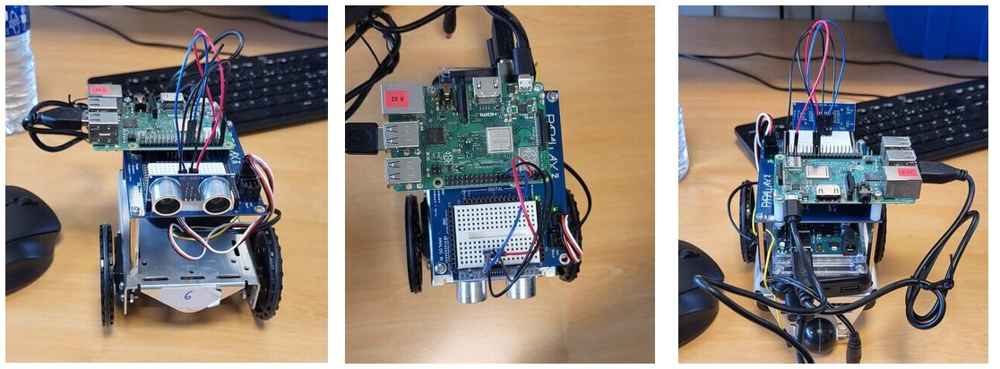
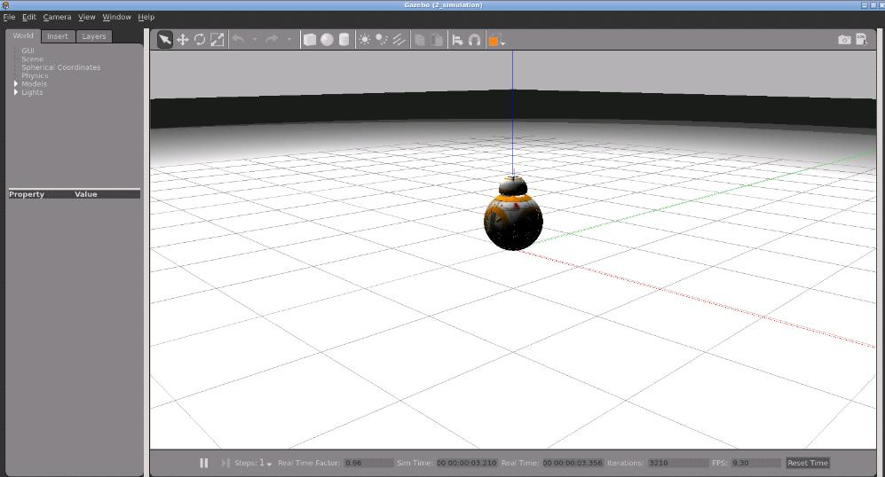
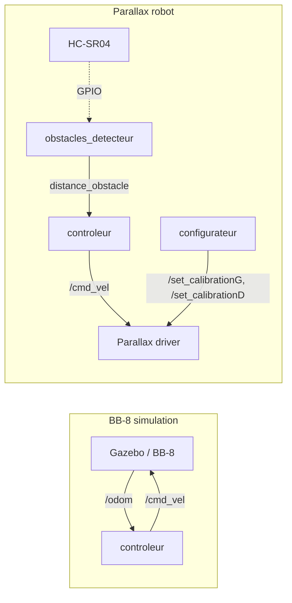

<div align="center">

# 🤖 ROS Mobile Robot Control

**Controlling differential-drive robots with ROS: a BB-8 in Gazebo simulation and a real Parallax robot on a Raspberry Pi 3**




</div>

> [!NOTE]
> 🇫🇷 **This project was carried out in French.** Code comments, log messages and function names (`avancer` = move forward, `reculer` = move back, `pivoter` = rotate…) are in French. This README is in English so the project can be read by a wider audience.

---

## 📖 About

Mini-project for the **Robotics** course (academic project, 2024–2025), carried out as a **team of two students**.

The goal was to write the ROS nodes that drive a **differential-drive mobile robot**, first in simulation, then on real hardware:

| | Part 1: BB-8 (simulation) | Part 2: Parallax (real robot) |
|---|---|---|
| **Platform** | Gazebo on The Construct (ROS Kinetic) | Parallax robot + Raspberry Pi 3 |
| **Inputs** | `/odom` (odometry) | HC-SR04 ultrasonic sensor (GPIO) |
| **Output** | `/cmd_vel` (`geometry_msgs/Twist`) | `/cmd_vel` → wheel servomotors |
| **Highlights** | trajectories, return-to-start detection | wheel calibration, obstacle stop, maze navigation |

## 🟠 Part 1: BB-8 in simulation

<div align="center">

</div>

Package: [`bb8_control`](bb8_control)

- **Velocity control**: `avancer`, `reculer`, `pivoter`, `stop` and `drive` (linear + angular speed) build a `geometry_msgs/Twist` published on `/cmd_vel`.
- **Rectangular trajectory**: timed straight lines and 90° turns (turn duration = π/2 ÷ angular speed).
- **Circular trajectory**: constant linear and angular speeds.
- **Odometry-based return detection (bonus)**: the controller subscribes to `/odom`, stores the start pose, converts the quaternion to a yaw angle, and computes the distance to the start. Once the robot has moved away (> 0.5 m) and comes back within 0.3 m, it **stops, waits 2 s and restarts in reverse**.
- [`scripts/reset.sh`](scripts/reset.sh) resets the Gazebo simulation between tests.

## 🔵 Part 2: Parallax robot

Package: [`parallax_control`](parallax_control)

### Wheel calibration
The continuous-rotation servos do not spin at the same speed for the same command, so the robot drifts. A `configurateur` node reads four **bias parameters** (left/right wheel, forward/backward) from [`run.launch`](parallax_control/launch/run.launch) and publishes them on `/set_calibrationG` and `/set_calibrationD`. The right wheel needed a much larger correction than the left one, even after replacing its screw and servo.

### Ultrasonic obstacle detection
The [`obstacles_detecteur`](parallax_control/src/obstacles_detecteur.cpp) node drives an **HC-SR04** through the Raspberry Pi GPIO (`libgpiod`, TRIG = GPIO 23, ECHO = GPIO 24):
1. sends a 10 µs trigger pulse;
2. measures the echo pulse width, with timeouts in case the echo never starts or never ends;
3. converts it to a distance (speed of sound 343 m/s, round trip) and publishes it in cm on `distance_obstacle` at 10 Hz.

[`tools/ultrasonic_test.cpp`](tools/ultrasonic_test.cpp) is the standalone program used to validate the sensor before integrating it into ROS.

### Obstacle-aware control and maze
The [`controleur`](parallax_control/src/controleur.cpp) node subscribes to `distance_obstacle`:
- **obstacle closer than 20 cm → stop**, otherwise keep moving;
- **maze navigation**: when an obstacle is detected the robot pivots to the right, otherwise it moves forward. The course maze could be solved by always turning right.

## 🧩 ROS architecture



## 🚀 Build & run

Both folders are **catkin packages** (ROS Kinetic, C++).

```bash
# in your catkin workspace
cd ~/catkin_ws/src
git clone <this-repository-url>
cd ~/catkin_ws && catkin_make && source devel/setup.bash
```

**BB-8 (Gazebo simulation running):**
```bash
roslaunch bb8_control run_bb8.launch
./src/ros-mobile-robot-control/scripts/reset.sh   # reset the robot pose
```

**Parallax (on the robot's Raspberry Pi, robot driver started):**
```bash
roslaunch parallax_control run.launch   # configurateur + controleur + obstacles_detecteur
```

> [!IMPORTANT]
> `parallax_control` uses the Raspberry Pi GPIO through `libgpiod` (wrapper in `include/rpi3/Gpiod.h`) and talks to the robot's own driver. It is meant to be built and run **on the robot**, not on a desktop PC.

## 📁 Repository structure

```
ros-mobile-robot-control/
├── bb8_control/              # Part 1: BB-8 simulation package
│   ├── launch/run_bb8.launch
│   └── src/controleur.cpp
├── parallax_control/         # Part 2: Parallax robot package
│   ├── launch/run.launch     # calibration biases + nodes
│   └── src/
│       ├── controleur.cpp
│       ├── obstacles_detecteur.cpp
│       ├── configurateur.cpp
│       └── afficheur.cpp
├── scripts/reset.sh          # reset the Gazebo simulation
├── tools/ultrasonic_test.cpp # standalone HC-SR04 test
└── docs/                     # images used in this README
```

## 🧠 What I learned

- ROS fundamentals: nodes, topics, publishers/subscribers, launch files and parameters, catkin builds.
- The gap between **simulation and real hardware**: a trajectory that is perfect in Gazebo drifts on a real robot until the wheels are calibrated.
- Low-level sensor interfacing on Linux through GPIO, and wrapping a sensor in a ROS node so the control logic stays independent from the hardware.
- Possible improvements: closed-loop turns (using odometry instead of timed rotations), hardware timing for the echo pulse, and a smarter maze strategy (wall following).

## 🙏 Credits

- **Starter packages** (`bb8_control`, `parallax_control`), project subject and lab setup: course instructor. Our work is in the `controleur` nodes, the Parallax `obstacles_detecteur` node, the calibration values, the sensor test program and the reset script.
- **Simulation environment:** [The Construct](https://www.theconstruct.ai/) (ROSject, Gazebo).

## 👤 Author

**Sivaharan Kumara Segaram**, embedded systems engineering student. Project carried out with a teammate.
